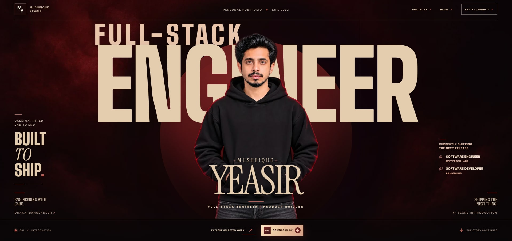

### Hi, I'm Mushfique 👋

Full-stack engineer in Dhaka, Bangladesh — 4+ years shipping Next.js, React and TypeScript products for teams in 5 countries.

**[Portfolio](https://mushfique-yeasir.netlify.app)** · **[Resume](https://drive.google.com/file/d/14fX_KWA9e9m2eSFlAd-58D-ZVc9UwMxF/view?usp=sharing)** · **[LinkedIn](https://www.linkedin.com/in/mushfique-yeasir/)** · **[Email](mailto:mushfiqueyeasir@gmail.com)**

### Skills

  <b>LANGUAGES</b> 
  
  
  
  

  <b>FRONTEND</b> 
  
  
  
  
  
  
  
  

  <b>BACKEND &amp; DATA</b> 
  
  
  
  
  
  

  <b>TOOLING &amp; DELIVERY</b> 
  
  
  
  
  

