

  
  
  
  
  

 

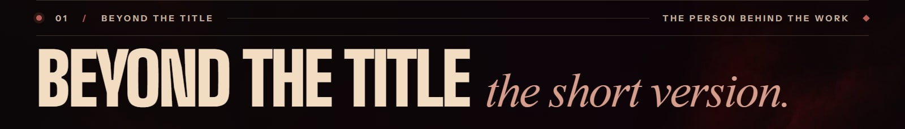

I'm **Mushfique Yeasir**, a full-stack engineer in **Dhaka, Bangladesh** turning ambiguous specs into calm, reliable products people enjoy using. For **4+ years** I've shipped production software for startups and product studios across **5 countries** — from AI-driven SaaS dashboards to high-end storefronts and marketing sites.

My focus is premium UI engineering, performant **Next.js** architectures and developer-experience-first code. I care about the small things that make software feel alive: motion, accessibility, type safety and polish.

- 💼 &nbsp;**Now** — Software Engineer at **MyTyTech Labs** (remote, US)
- 🧭 &nbsp;**Focus** — Next.js · React · TypeScript · Node.js · Supabase · Parse
- 🎓 &nbsp;**Education** — B.Sc. in Computer Science & Engineering, East West University (2021)
- ✳️ &nbsp;**Open to** — remote roles and freelance product builds

 

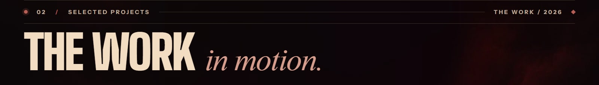

<table>
  <tr>
    <td width="50%" valign="top">
      <a href="https://www.reverbsolution.com/">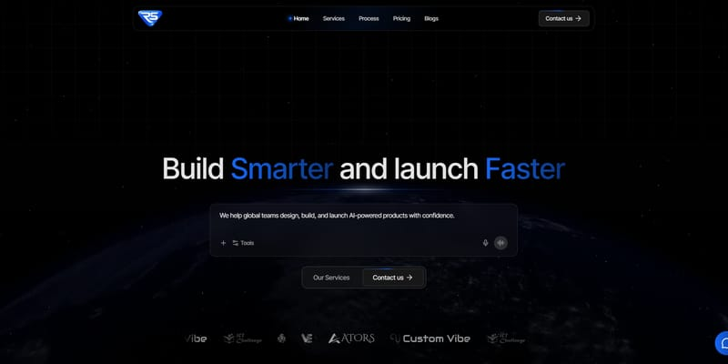</a>
      <h3>Reverb Solution</h3>
      <b>SOFTWARE STUDIO · PLATFORM · 2026</b> 
      Global software studio — websites, custom SaaS, mobile apps, e-commerce, AI &amp; LLM products and workflow automation.
    </td>
    <td width="50%" valign="top">
      <a href="https://yearn.media/">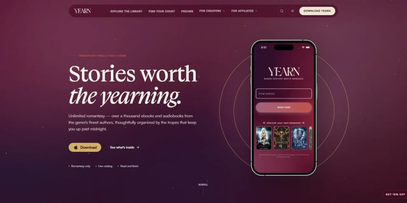</a>
      <h3>Yearn</h3>
      <b>ROMANTASY SUBSCRIPTION · MEDIA · 2026</b> 
      One subscription for a growing catalog of romantasy ebooks and audiobooks, organized by the tropes readers crave.
    </td>
  </tr>
  <tr>
    <td width="50%" valign="top">
      <a href="https://www.forkastrestaurants.com/">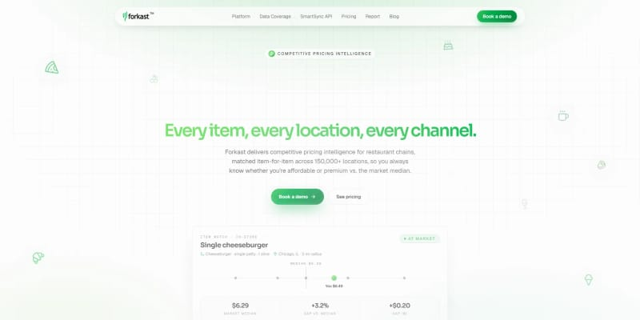</a>
      <h3>Forkast</h3>
      <b>PRICING INTELLIGENCE · SAAS · 2026</b> 
      Competitive pricing data for restaurant chains across 150,000+ locations — item, location and channel level.
    </td>
    <td width="50%" valign="top">
      
      <h3>Courtroom</h3>
      <b>LITIGATION AI · SAAS · 2025</b> 
      Battle-test cases before trial with simulated jurors and judges — built for privilege and enterprise security.
    </td>
  </tr>
  <tr>
    <td width="50%" valign="top">
      <a href="https://www.vegear.com/">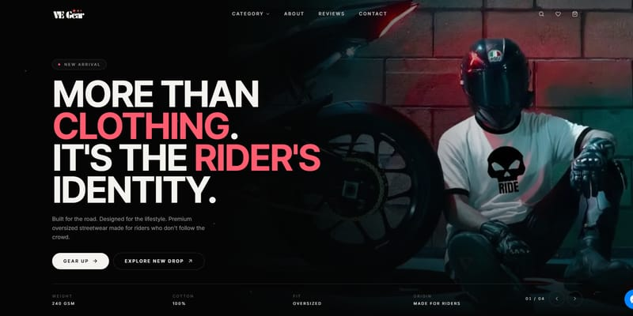</a>
      <h3>VE Gear</h3>
      <b>RIDER STREETWEAR · COMMERCE · 2026</b> 
      Premium rider streetwear — heavyweight oversized drops, limited editions, BDT pricing and cart checkout.
    </td>
    <td width="50%" valign="top">
      <a href="https://kawaii.com.bd/">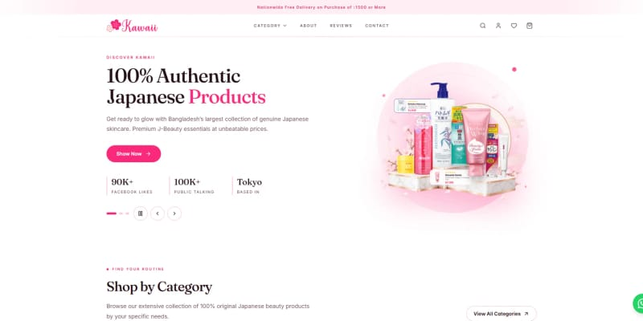</a>
      <h3>Kawaii</h3>
      <b>J-BEAUTY STOREFRONT · COMMERCE · 2026</b> 
      Authentic Japanese skincare for Bangladesh — category-led catalog, routine finder, reviews and fast delivery.
    </td>
  </tr>
</table>

  <a href="https://mushfique-yeasir.netlify.app/projects"><b>Explore all 12 projects →</b></a>
  &nbsp;·&nbsp; ATORS · Custom Vibe · MiniCo · ICT Challenge · Yomikata Academy · Falcon Fitness

 

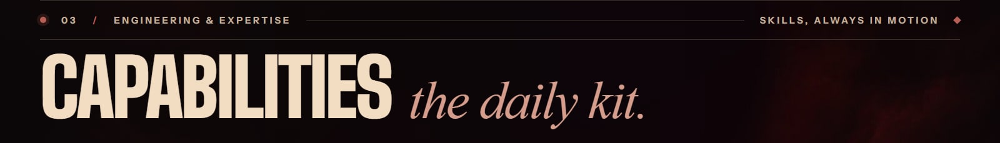

  <b>LANGUAGES</b> 
  
  
  
  

  <b>FRONTEND</b> 
  
  
  
  
  
  
  
  

  <b>BACKEND &amp; DATA</b> 
  
  
  
  
  
  

  <b>TOOLING &amp; DELIVERY</b> 
  
  
  
  
  

 

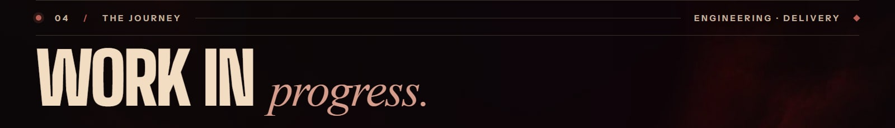

| | Role | Company | Where | Stack |
|:--:|:--|:--|:--|:--|
| 2023 — **NOW** | **Software Engineer** | MyTyTech Labs | Silicon Valley, US · remote | Next.js · TypeScript · Supabase · Parse |
| 2024 — 2025 | **Software Developer** | BEM Group | Dubai, UAE | Next.js · React · Tailwind |
| 2023 | **Software Engineer** | Wires International | Mumbai, India | React · Next.js · Node · MongoDB |
| 2022 — 2023 | **Software Engineer** | Mezink | Singapore | Next.js · TypeScript · Emotion |
| 2022 — 2023 | **Web Developer** | Bangla Haat International | Dhaka, Bangladesh | React · Node · Express |
| 2022 | **Software Engineer** | Stitchworks Software | Gujarat, India | React · JavaScript |

 

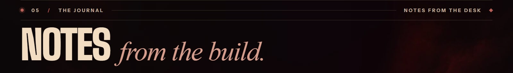

- **[Vibe Coding: The Speed Trap, the Real Drawbacks, and a Better Way to Build](https://mushfique-yeasir.netlify.app/blogs/Vibe_Coding_Speed_Trap)** · APR 2026 · 7 MIN
- **[Developer Work-Life Balance: Boundaries That Actually Stick in 2026](https://mushfique-yeasir.netlify.app/blogs/Developer_Work_Life_Balance)** · APR 2026 · 8 MIN
- **[Staying Current When Technology Never Stops Moving: A Calm Learning Strategy](https://mushfique-yeasir.netlify.app/blogs/Staying_Current_With_Tech)** · APR 2026 · 8 MIN

Subscribe via <a href="https://mushfique-yeasir.netlify.app/feed.xml">RSS</a> · AI agents: <a href="https://mushfique-yeasir.netlify.app/llms.txt">llms.txt</a>

 

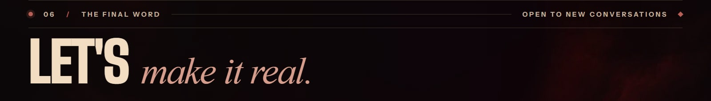

From a striking storefront to a complex SaaS platform, I love turning ambitious ideas into products that *actually ship*. Tell me what you're building.

  
  
  
  
  

 

<a href="https://mushfique-yeasir.netlify.app">
  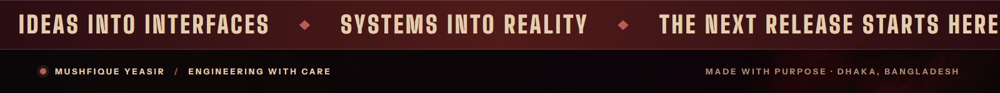
</a>
